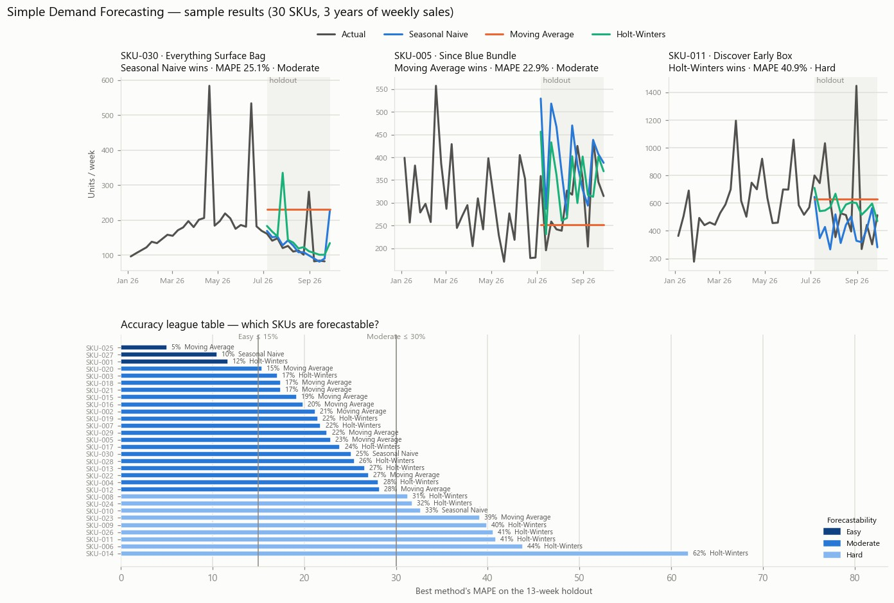

# Simple Demand Forecasting

*How can a small business forecast next month's demand?*

A small pipeline that generates a fake three-year weekly sales history for ~30 SKUs,
validates it, and runs three simple forecasting methods against it — scoring each
method on a holdout quarter, picking a winner per SKU, and writing the data, the
forecasts, an accuracy league table and the resulting safety stock into a single
Excel workbook.

**Why SMEs care:** Q4 ordering decisions are being made now, and every inventory
calculation (EOQ, safety stock, reorder point) assumes demand is known. This closes
that loop: it shows how to produce a demand forecast from plain sales history, how to
measure how wrong it is, and how that error feeds straight into safety stock.

The methods are the standard textbook ones, implemented in plain Python (no numpy,
pandas or statsmodels) so every step is readable:

- **Seasonal naive baseline** — next week's forecast is the same week one season (52 weeks) ago.
- **Moving average** — the mean of the last 8 weeks, held flat over the horizon.
- **Holt-Winters (ETS)** — additive level + trend + seasonality, with the smoothing
  parameters chosen by a small grid search on in-sample one-step error.
- **Accuracy on a holdout** — the last 13 weeks are held back; each method is scored with
  **MAE** (mean absolute error), **MAPE** (mean absolute percentage error, zero-demand weeks
  skipped) and **RMSE**. The method with the lowest MAE wins the SKU.
- **Forecast bias** — mean signed error (forecast − actual); positive means you are
  systematically over-forecasting and will over-order.
- **Forecast error → safety stock** — `z(service level) × RMSE of the winning forecast × sqrt(lead time in weeks)`,
  shown next to the "ignore the forecast" version based on the raw std. dev. of weekly demand.
  Reorder point = forecast demand over the lead time + safety stock.
- **Which SKUs are forecastable** — SKUs are banded by the winner's MAPE:
  **Easy** (≤ 15%), **Moderate** (15–30%), **Hard** (> 30%).

## How it works

Three scripts, run in order, each consuming the previous one's output:

1. **`generate_data.py`** — uses [Faker](https://faker.readthedocs.io/) to create a SKU
   master (`data/sku_master_raw.csv`: name, category, price, lead time, service level) and
   three years of weekly unit sales per SKU (`data/weekly_sales_raw.csv`). Each SKU's demand
   is built from a base level plus a gentle trend, a yearly seasonal wave, an optional Q4
   peak, random promo weeks with a 1.6–3× lift, and noise; roughly one SKU in eight is a slow,
   lumpy mover. A small percentage of sales rows are deliberately corrupted (negative units,
   blank fields, impossible dates, unknown SKUs, a duplicate week) so the next step has real
   errors to catch.
2. **`validate_data.py`** — checks every row of both CSVs against the schemas in
   `forecast_common.py` (via [pydantic](https://docs.pydantic.dev/)), drops invalid rows,
   duplicate SKUs, duplicate SKU/week pairs and sales for SKUs missing from the master, and writes:
   - `data/sku_master_validated.csv` and `data/weekly_sales_validated.csv` — the clean rows
   - `data/validation_report.txt` — what was rejected and why
3. **`forecast_demand.py`** — reads the validated CSVs, rebuilds one gap-free weekly series
   per SKU (weeks the validator dropped are linearly interpolated and counted), holds back the
   last 13 weeks, fits and scores the three methods, and writes a new
   `output/demand_forecast.xlsx` workbook with seven sheets:
   - **Input Data** — the validated weekly sales the forecasts ran on
   - **SKU Master** — the static SKU attributes
   - **Accuracy League Table** — one row per SKU ranked by the winner's MAPE: MAE / MAPE / bias
     for every method, the winning method, demand volatility, and the forecastability class
     (Moderate rows shaded yellow, Hard rows shaded red)
   - **Forecast vs Actual** — every holdout week per SKU, with each method's forecast beside
     the actual and the winner's error
   - **Next Month Forecast** — the winner re-fitted on the full history, its forecast for the
     next 4 weeks, and the safety stock and reorder point implied by its forecast error
   - **Forecastability** — roll-up by Easy / Moderate / Hard: SKU count, share of volume,
     average MAPE and how often each method won
   - **Charts** — forecast vs actual line charts for the six highest-volume SKUs

`forecast_common.py` holds the shared data models, file paths and tuning constants
(season length, holdout length, horizon, moving-average window, forecastability bands)
used by all three scripts.

> **Example Results** : [sample_results.xlsx](./sample_results.xlsx)


## Setup

### 1. Get the code

```powershell
git clone <your-repo-url>
cd simple-demand-forecasting
```

### 2. Create and activate a virtual environment

**Windows (PowerShell):**

```powershell
python -m venv .venv
.venv\Scripts\Activate.ps1
```

**macOS / Linux:**

```bash
python3 -m venv .venv
source .venv/bin/activate
```

### 3. Install dependencies

```powershell
pip install -r requirements.txt
```

Requires Python 3.10+ (uses `statistics.NormalDist` and PEP 604 type hints — no `numpy`,
`pandas` or `statsmodels` needed).

## Usage

Run the three scripts in order from the project root, with the virtual environment
activated:

```powershell
python generate_data.py --skus 30 --weeks 156 --error-rate 0.02 --seed 42
python validate_data.py
python forecast_demand.py
```

Then open `output/demand_forecast.xlsx`.

### Options

| Script | Flag | Default | Description |
| --- | --- | --- | --- |
| `generate_data.py` | `--skus` | `30` | Number of fake SKUs to generate |
| | `--weeks` | `156` | Weeks of history to generate (156 = 3 years) |
| | `--end` | most recent Monday | Monday of the last week of history (ISO date) |
| | `--error-rate` | `0.02` | Fraction of sales rows to deliberately corrupt (`0` for a perfectly clean dataset) |
| | `--seed` | none | Random seed, for reproducible output |
| | `--sales-output` | `data/weekly_sales_raw.csv` | Where to write the raw sales |
| | `--master-output` | `data/sku_master_raw.csv` | Where to write the SKU master |
| `validate_data.py` | `--sales-input` | `data/weekly_sales_raw.csv` | Sales file to validate |
| | `--master-input` | `data/sku_master_raw.csv` | SKU master to validate |
| | `--sales-output` | `data/weekly_sales_validated.csv` | Where to write the cleaned sales |
| | `--master-output` | `data/sku_master_validated.csv` | Where to write the cleaned SKU master |
| | `--report` | `data/validation_report.txt` | Where to write the rejection report |
| `forecast_demand.py` | `--sales-input` | `data/weekly_sales_validated.csv` | Sales file to forecast from |
| | `--master-input` | `data/sku_master_validated.csv` | SKU master to read lead times / service levels from |
| | `--output` | `output/demand_forecast.xlsx` | Where to write the results workbook |

Every script can also point at a custom input/output path, so you can drop in your own
real weekly sales CSV and SKU master (matching the columns in `forecast_common.py`) and
run them straight through `validate_data.py` and `forecast_demand.py`, skipping
`generate_data.py`. Holt-Winters needs at least two full seasons (104 weeks) of history;
with less it falls back to the moving average for that SKU.

## Reading the results

- **Start with the Forecastability sheet.** If most of your volume sits in Easy / Moderate
  SKUs, a simple method is good enough for Q4 ordering; the Hard tail needs judgement,
  more safety stock, or a different approach (e.g. intermittent-demand methods).
- **Then the league table.** A large positive bias means you will over-order every week;
  a large negative bias means stockouts. A method can have a fine MAPE and still be biased.
- **Then Next Month Forecast.** Compare the two safety stock columns: when a forecast
  captures the seasonality, its error is smaller than raw demand variability, so the
  safety stock it implies is lower — that is the inventory saving a forecast buys you.

## Project layout

```
simple-demand-forecasting/
├── forecast_common.py      # shared schemas, file paths, tuning constants
├── generate_data.py        # step 1: fake SKU master + weekly sales generation
├── validate_data.py        # step 2: schema validation / cleaning
├── forecast_demand.py      # step 3: seasonal naive / moving average / Holt-Winters -> Excel
├── requirements.txt
├── data/                    # generated CSVs + validation report (not committed)
└── output/                  # generated Excel workbook (committed)
```

`data/` is gitignored (apart from a `.gitkeep` placeholder) since its contents are
reproducible by re-running the scripts — as is `.venv/`, so the virtual environment
itself is never pushed to the repo. `output/` is committed, so the latest results
workbook always ships with the code.


> **Disclaimer** — This software is provided for educational and demonstration purposes only. See the full [Disclaimer & EULA](./DISCLAIMER.md) for details.
